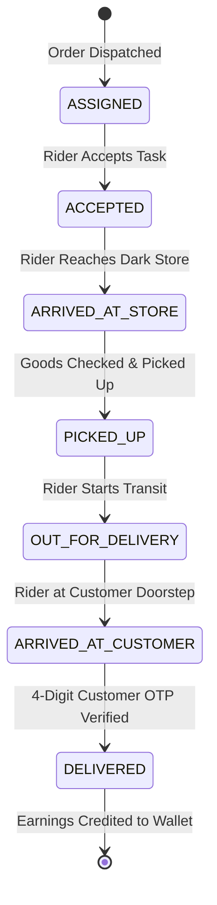

# GROVIA Rider Portal & Field Operations Guide
## Fresh Living. Smarter Shopping.

### Overview
The **GROVIA Dedicated Delivery Rider Portal** is a mobile-first, high-contrast, touch-optimized field operations application engineered for delivery partners across India. It supports 10-minute quick delivery fulfillment, live turn-by-turn navigation, customer OTP delivery handoff verification, shift availability toggling, and automated earnings calculation.

---

### Access & Initial Credentials
- **Access Route**: `http://localhost:3000/rider/login`
- **Roster Role**: `RIDER`
- **Initial Login ID**: `rider_me` (or phone `+91 98765 43210`)
- **Initial Password**: `Rider@9682pw`
- **Security Policy**: Initial password requires mandatory reset on first login via the in-app password dialog. Repeated failed attempts trigger a 15-minute security lockout.

---

### Key Portal Routes & Experiences

| Route | Page Name | Primary Features |
|---|---|---|
| `/rider/login` | Rider PIN Authentication | High-contrast login with phone/username, quick credential fill for audit testing. |
| `/rider/dashboard` | Ops Command Center | Online/Offline toggle, active assignment banner, today's trips & earnings, rating card. |
| `/rider/orders` | Trip & Order Queue | Filter tabs for Active, Completed, and All assigned deliveries. |
| `/rider/orders/[id]` | Order Lifecycle & Proof | Dark store pickup details, customer drop-off details, goods checklist, and 7-stage status workflow with customer OTP verification. |
| `/rider/navigation` | Turn-by-Turn GPS | Interactive SVG routing map, device Geolocation tracking, step directions, speed & ETA telemetry, and Google Maps deep link. |
| `/rider/earnings` | Payouts & Wallet | Weekly auto-settlement wallet, per-trip rate card (₹40 base + distance surcharge + 100% tip), and historical trip credits. |
| `/rider/profile` | Partner Account & Security | Vehicle registration, commercial driving license, active dark store hub, password changer, and sign-out. |
| `/rider/availability` | Shifts & Duty Log | Scheduled shift calendar, daily active duty hours, and break logs. |
| `/rider/support` | Field Support & SOS | High-priority Emergency SOS button with GPS broadcast, dark store manager contact, and issue reporting. |

---

### 7-Stage Order Delivery Lifecycle State Machine

Riders advance the delivery process through strict server-validated lifecycle steps:

1. **`ASSIGNED`**: Order dispatched to rider; rider reviews payout, store pickup, and delivery address.
2. **`ACCEPTED`**: Rider accepts order; dark store preparing items is notified.
3. **`ARRIVED_AT_STORE`**: Rider arrives at dark store/fulfillment center.
4. **`PICKED_UP`**: Rider checks off items on checklist and confirms bag pickup.
5. **`OUT_FOR_DELIVERY`**: Rider starts navigation towards the customer doorstep.
6. **`ARRIVED_AT_CUSTOMER`**: Rider arrives at customer building/doorstep.
7. **`DELIVERED`**: Customer presents 4-digit verification OTP (e.g. `9682`). System verifies OTP, updates order to `DELIVERED`, records delivery proof, and credits ₹80.00 trip fee to the rider's wallet.

---

### Real Geolocation Telemetry
- Uses HTML5 `navigator.geolocation.watchPosition` with fallback graceful simulation.
- Telemetry endpoint: `POST /api/rider/location` updates rider coordinates and live delivery position.
- Customer order tracking at `/order-tracking/[id]` reflects rider's moving position in real time.
